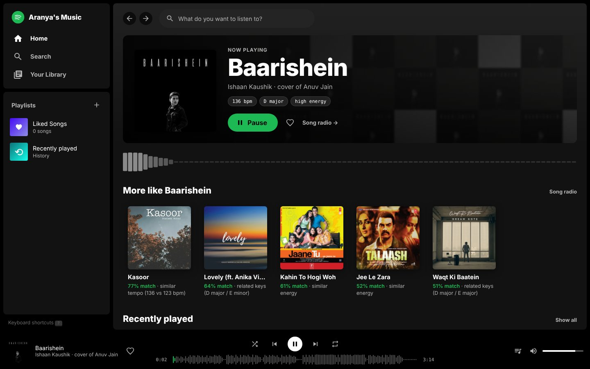
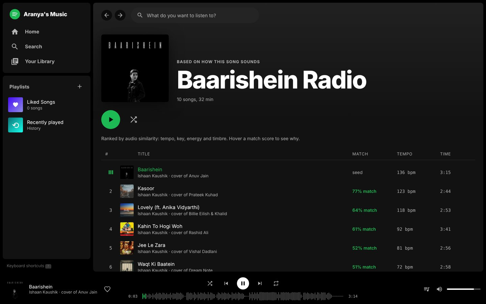

# Spotify Clone: web player with audio-based recommendations

A Spotify-style music player written in plain HTML, CSS and JavaScript, with no framework and no build step. It plays a small library of acoustic covers by **Ishaan Kaushik**.

It started as a UI clone. The part I find more interesting now is that it analyses the actual audio (tempo, key, energy, timbre) and uses that for **"More like this"**, **Song radio** and a **smooth shuffle** mode that orders songs so each one flows into the next. All of this works without any listening history or server.

**Live demo:** https://aranya2801.github.io/Spotify-Clone-Web-Development/



## Features

**Player**
- Play/pause, next/previous, seek, volume, mute
- Shuffle has three modes: off → random → smooth (by sound)
- Repeat: off → all → one
- Waveform seek bar, drawn from the real audio peaks (works with touch too)
- Live frequency visualiser (Web Audio API), coloured from the current album cover
- Lock-screen / media-key controls through the Media Session API
- Remembers the last song and position across reloads

**Library**
- Liked songs, recently played, and your own playlists (create, rename inline, delete with undo)
- Queue panel with "Play next" / "Add to queue", like Spotify's
- Search across title, original artist, genre, mood and key (`minor`, `D major`, ...)
- Sort the library by title, duration, tempo or energy
- Works offline after the first visit (service worker)
- Keyboard shortcuts for everything (press `?` in the app)

**Recommendations**
- "More like this" shelf on the home page, with a match % and a short reason ("similar tempo (136 vs 123 bpm)")
- Song radio: every track ranked by similarity to a seed song
- Browse buckets like *Calm & slow* and *Upbeat* that come from the features, not hand-written tags



## How the recommendations work

### 1. Feature extraction (offline, Python)

`tools/extract_features.py` runs [librosa](https://librosa.org) over every mp3 and writes `data/features.json` (about 24 KB). For each track it stores:

| Group | Features |
|---|---|
| Rhythm | tempo (beat tracker), onset strength, beat regularity (std of inter-beat intervals) |
| Harmony | key, estimated with Krumhansl–Schmuckler profiles on the mean chroma |
| Dynamics | mean and std of RMS energy |
| Timbre | spectral centroid, rolloff, zero-crossing rate, MFCC 1–12 |
| (display) | 160-point waveform for the seek bar |

I do this offline rather than in the browser. Decoding ten mp3s with `OfflineAudioContext` on page load took about 4 s and froze the UI.

### 2. Similarity (in the browser)

`js/similarity.js` turns each track into a vector and compares tracks group by group:

- Every feature is **z-scored** across the library, then averaged *within* its group. Without this, the 12 MFCCs would outweigh the single tempo value.
- **Tempo is folded into one octave** (70–140 bpm). Beat trackers often lock on to half or double time, so 152 and 76 bpm should count as the same feel.
- **Key goes on the circle of fifths** as (cos, sin), with minor keys mapped to their relative major (Camelot-wheel style). A minor and C major sit on the same spot, and C and G are neighbours.
- The groups are combined with weights (rhythm 1.0, dynamics 1.0, timbre 0.8, harmony 0.6).

The match % is calibrated so **50% = about as similar as a typical pair in this library**. The raw distance doesn't mean much on its own.

### 3. Smooth shuffle

Choosing an order where consecutive songs are as close as possible is an open **travelling-salesman path**. The player:

1. builds a nearest-neighbour path from the current song, sometimes taking the 2nd-nearest so two shuffles don't come out identical,
2. cleans it up with **2-opt**.

With 10 songs I can also compute the exact optimum (Held–Karp DP), which gives the heuristic something honest to be compared against. `node tools/evaluate.mjs`:

| Ordering | Path cost ↓ | vs. optimal | Avg tempo jump (bpm) ↓ | Key-compatible transitions ↑ |
|---|---|---|---|---|
| Random shuffle | 12.59 | +26.2% | 26.7 | 18% |
| Greedy nearest-neighbour | 10.47 | +4.9% | 14.4 | 20% |
| **Smooth shuffle** | **10.10** | **+1.2%** | 15.8 | 21% |
| Optimal (Held–Karp) | 9.98 | +0.0% | 16.4 | 16% |

*1000 runs each, seeded.*

Smooth shuffle gets within ~1% of the best possible order and still varies from run to run. Tempo jumps between songs drop by about 40% compared with random. Key compatibility barely moves. With 10 songs spread over 9 different keys there aren't many compatible pairs to begin with, so harmony only gets a 0.6 weight.

### Limitations

- 10 tracks is tiny. The numbers above show the method works, but they say nothing about how good the recommendations are to a listener. That would need a listening test.
- The beat tracker is not perfect on soft acoustic recordings (track 10 came out at 81 bpm, which may be half its real tempo).
- Key detection on a single mean chroma vector misses modulations.
- Weights were tuned by ear, not learned.

## Project structure

```
├── index.html
├── css/style.css
├── js/
│   ├── app.js          UI, routing (#/library, #/radio/04, ...), events
│   ├── tracks.js       track list
│   ├── similarity.js   feature vectors, distance, smooth shuffle (TSP + 2-opt)
│   ├── queue.js        playback order, shuffle/repeat, play-next queue
│   ├── store.js        localStorage (likes, playlists, last position)
│   ├── visualizer.js   spectrum + waveform seek bar
│   └── utils.js
├── data/features.json  generated by tools/extract_features.py
├── assets/
│   ├── audio/          01.mp3 … 10.mp3
│   ├── covers/         album art
│   └── banners/
├── tools/
│   ├── extract_features.py
│   └── evaluate.mjs    smooth shuffle vs random vs optimal
├── tests/              node:test unit tests
└── sw.js               offline cache
```

`queue.js` and `similarity.js` don't touch the DOM, so they're unit tested in Node directly.

## Running it

It needs to be served over HTTP. ES modules and the Web Audio analyser don't work from `file://`.

```bash
git clone https://github.com/Aranya2801/Spotify-Clone-Web-Development.git
cd Spotify-Clone-Web-Development
python -m http.server 3000        # or: npx serve -l 3000 .
```

Then open http://localhost:3000.

Tests and the evaluation (Node 18+):

```bash
npm test
npm run eval
```

Re-extracting features after adding songs:

```bash
pip install -r tools/requirements.txt
python tools/extract_features.py
```

To add a song: drop `11.mp3` into `assets/audio/` and a cover into `assets/covers/`, add a line to `js/tracks.js`, then re-run the feature script.

## Keyboard shortcuts

| Key | Action |
|---|---|
| `Space` | Play / pause |
| `←` `→` | Seek 5 s |
| `Shift` + `←` `→` | Previous / next |
| `↑` `↓` | Volume |
| `S` | Shuffle mode |
| `R` | Repeat mode |
| `M` | Mute |
| `L` | Like current song |
| `Q` | Queue |
| `/` | Search |
| `1`–`0` | Play track 1–10 |

## Credits

- Songs performed by **Ishaan Kaushik**. Original artists are listed in the app.
- Cover art belongs to the respective artists and labels and is used here for a non-commercial demo only.
- UI inspired by Spotify. This project is not affiliated with Spotify.

## License

Code is MIT, see [LICENSE](LICENSE). The audio and artwork are not covered by it.
